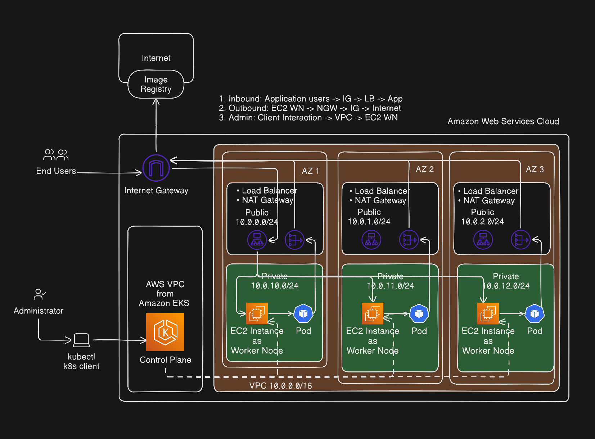

Parte 1: https://blog.fcosanabria.com/posts/devops-project-imp para mas informacion sobre como luce la arquitectura del sample app y como se implementa usando Docker Compose. 

# Parte 2

Ha pasado bastante tiempo desde que escribí la primera parte de este proyecto, y no he tenido tiempo de escribir la segunda parte, pero finalmente he podido avanzar un poco más en el proyecto y quiero compartirlo con ustedes.

En esta segunda parte, voy compartirles la idea que tengo sobre el cluster de Kubernetes y su arquitectura.

Como se puede ver en este diagrama, la arquitectura que quiero implementar es bastante sencilla, pero que me permitira escalar sobre la marcha, y que me permitirá tener un control amplio sobre los recursos que quiero usar. 

Hay basicamente 3 flujos de comunicación, que definen el porque de esta decision. 

El primero es el flujo de comunicación entre los usuarios finales y la aplicación. El cual pretendo usar Internet Gateway y un Load Balancer para poder distribuir la carga de trabajo entre los distintos pods que se van a crear en el cluster de Kubernetes.

El segundo flujo es de adentro hacia afuera. Donde los EC2 worker nodes van a poder comunicarse con el exterior para poder descargar las imagenes de los contenedores y poder actualizarse. Esto es importante, ya que si no se tiene acceso a internet, no se podran descargar esas imagenes y por lo tanto no se podran ejecutar los pods. Esto via NAT Gateway, que es un servicio de AWS que permite a los recursos dentro de una VPC privada acceder a internet sin exponerlos directamente a una red pública.

Y por ultimo, considere la comunicacion que tiene el admin via cualquier cliente de kubernetes, como kubectl, con el cluster de Kubernetes. Esto via el VPC que el mismo EKS crea, y que permite interactuar con los workloads y recursos del cluster. 

Tambien se puede notar, que cada uno de los nodos se encuentra en una subred distinta, y en Availability Zones distintas. Lo hice meramente por motivos de diseno, y es lo que normalmente se haria. Pero probablemente para mi testeo no vaya a ser necesario, ya que no voy a tener un gran trafico de usuarios, y por lo tanto no voy a necesitar de una alta disponibilidad. Solo que es bueno tenerlo en cuenta para cuando se quiera escalar el proyecto.

Ya con esto, ya tengo una idea de como quiero que se vea la arquitectura del cluster de Kubernetes, y ahora lo que me queda es implementarlo y probarlo.

Ahora, tengo un Terraform Remote Backend, que me permite tener un control de los recursos que estoy creando y poder versionarlos.